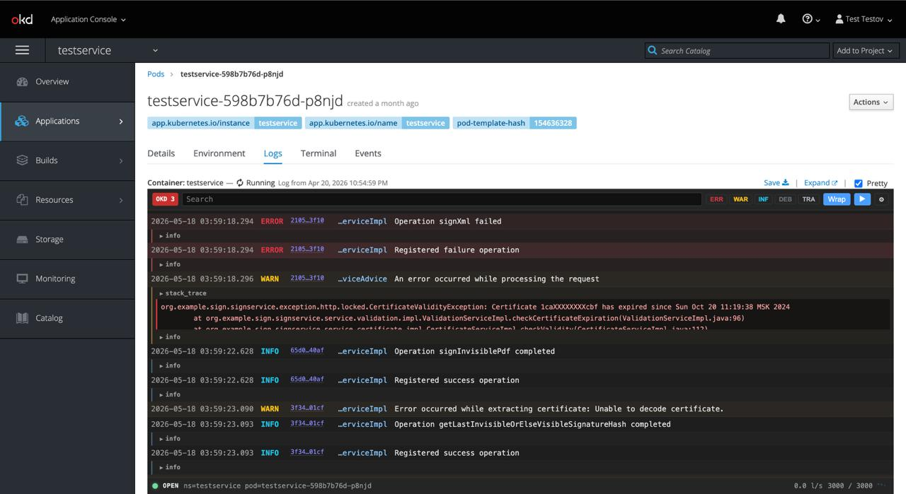
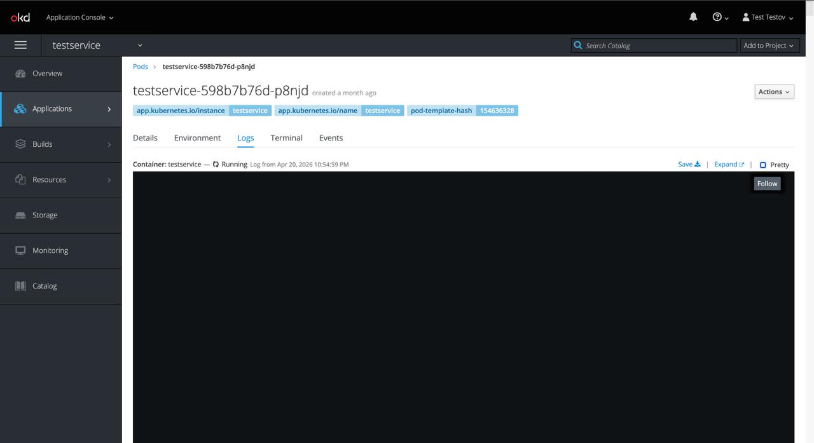
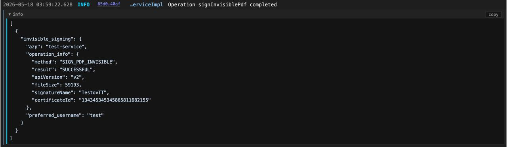
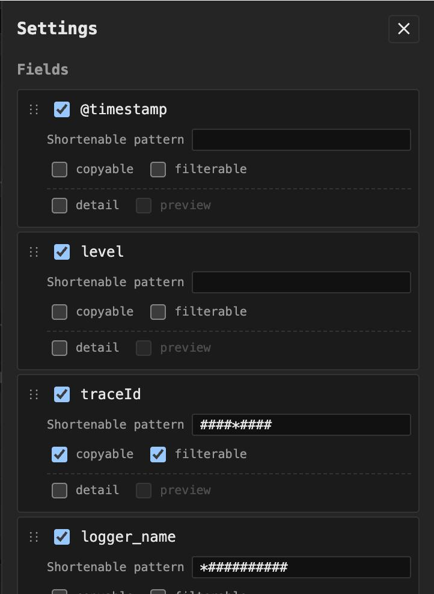
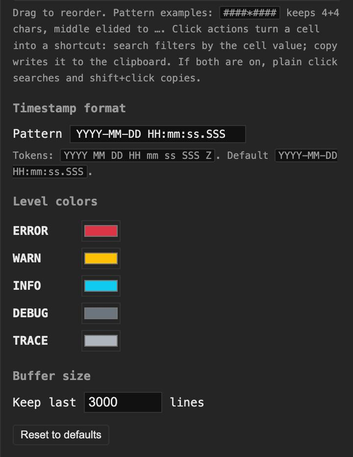

# OKD Pretty Logs

A Chrome / Chromium extension that drops a virtualized, sortable, filterable
log table on top of the native pod-logs page in OKD 3 (Angular console) and
OKD 4 (React / PatternFly console). One click on the **Pretty** button injected
into the native log toolbar reformats the raw JSON stream into a structured
view, with per-field columns, search, level filtering and pinned column
widths.



## Features

- **Drop-in.** No configuration per cluster — works on any OKD instance the
  user can reach. URL-pattern detection picks the right variant (OKD 3 vs
  OKD 4) automatically.
- **Native toolbar integration.** Injects a `Pretty` toggle into the native
  log-viewer toolbar; staying off-toggle leaves the OKD UI untouched.
- **Virtualized table.** Only rows around the visible viewport are mounted;
  scrolls smoothly through tens of thousands of entries.
- **Pinned column widths.** Columns don't shimmy as outliers scroll in and
  out of the visible window.
- **Per-field configuration.** Visibility, order, click-to-copy, click-to-
  filter, short-pattern eliding (e.g. `####*####`), and inline-vs-detail
  rendering, all configurable per field.
- **Detail sub-rows.** Object / array values, stack traces and any field
  marked as a detail render as an expandable JSON / text block below the
  main row.
- **Live filter.** Debounced full-text search and per-level toggles, applied
  on the full ring buffer.
- **Auto-reconnect.** When OKD ends the stream (idle timeout, `limitBytes`,
  watch timeout), one click on the reconnect button re-wiggles the route to
  start a fresh WebSocket.
- **Multi-line JSON support.** Pretty-printed JSON entries that span many
  newline-delimited fragments are merged back into a single log entry by
  brace counting.

## Install

### From a release (recommended)

1. Download the latest `okd-pretty-logs-vX.Y.Z.zip` from the
   [Releases page](https://github.com/dmittriy13/okd-pretty-logs/releases).
2. Unzip it anywhere.
3. Open `chrome://extensions`, enable **Developer mode**, click
   **Load unpacked**, and select the unzipped folder.

No Node / npm required — the zip already contains the built extension.

### From source

```sh
git clone https://github.com/dmittriy13/okd-pretty-logs.git
cd okd-pretty-logs
npm install
npm run build
```

Then in Chrome: open `chrome://extensions`, enable **Developer mode**, click
**Load unpacked**, and select the `dist/` directory.

### From the Chrome Web Store

Not published yet — see **From a release** above.

## Usage

1. Open any pod's **Logs** tab in the OKD console. The extension injects a
   **Pretty** checkbox into the native log toolbar:

   

2. Click **Pretty** to mount the overlay. The toolbar above the overlay has
   search, level toggles, wrap mode, pause auto-scroll and the **⚙** settings
   button.
3. Any non-empty object/array field — and any field you explicitly mark as
   "detail" in settings — renders as an expandable sub-row with a `copy`
   button:

   

4. The **⚙** drawer is where you configure per-field behaviour (visibility,
   drag-to-reorder, click-to-copy / click-to-filter, short-pattern eliding),
   timestamp pattern, level colors and ring buffer size:

   <p>
     
     
   </p>

The toggle's state, configuration, and active filters are persisted per
origin (hashed) in `chrome.storage.sync`.

## Architecture

- **`src/inject/ws-hook.ts`** runs in the page's MAIN world at
  `document_start` and replaces `window.WebSocket` with a thin wrapper that
  posts every pod-log frame through `window.postMessage`. The wrapper only
  intercepts URLs matching the pod-log endpoint pattern; everything else
  passes through unchanged.
- **`src/inject/okd-tab-mount.ts`** is the content script. It receives
  framed messages from the ws-hook, decodes the base64 + JSON stream
  (with multi-line merging), maintains a ring buffer, and injects the
  Pretty toggle into the native log toolbar. On toggle-on it mounts the
  panel into a shadow-DOM overlay sized to the native log area.
- **`src/panel/panel-view.ts`** plus modules under `src/panel/internal/`
  render the table: virtualization math, column pin widths, detail
  sub-rows, settings drawer, footer, etc.
- **`src/shared/`** holds pure utilities: parser, formatters, OKD-variant
  detection, storage abstraction over `chrome.storage.sync`.

## Development

```sh
npm install         # install dependencies
npm run watch       # esbuild in watch mode
npm run typecheck   # tsc --noEmit
npm test            # vitest run
npm run lint        # eslint src tests
npm run format      # prettier --write
npm run build       # production build into dist/
```

After `npm run watch`, reload the extension in `chrome://extensions` to pick
up the rebuilt bundles.

## License

[MIT](./LICENSE) © Dmitry Tsypov
